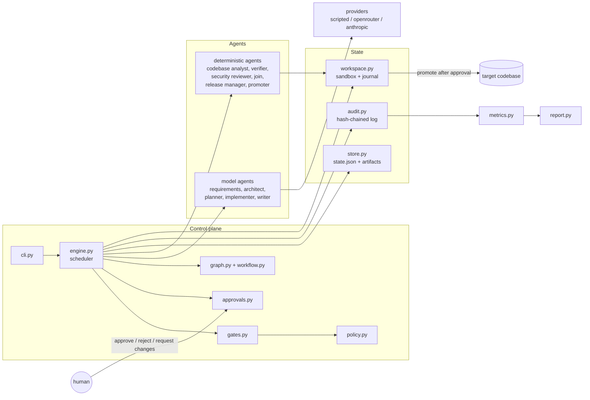
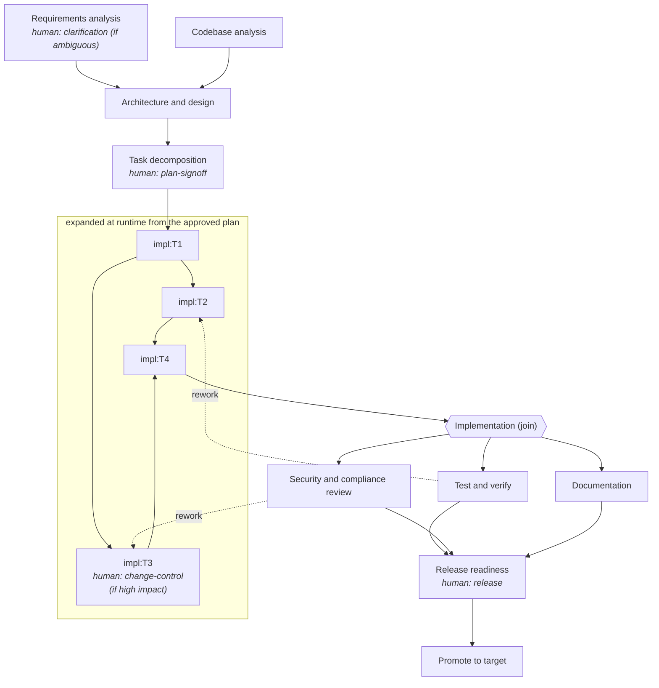
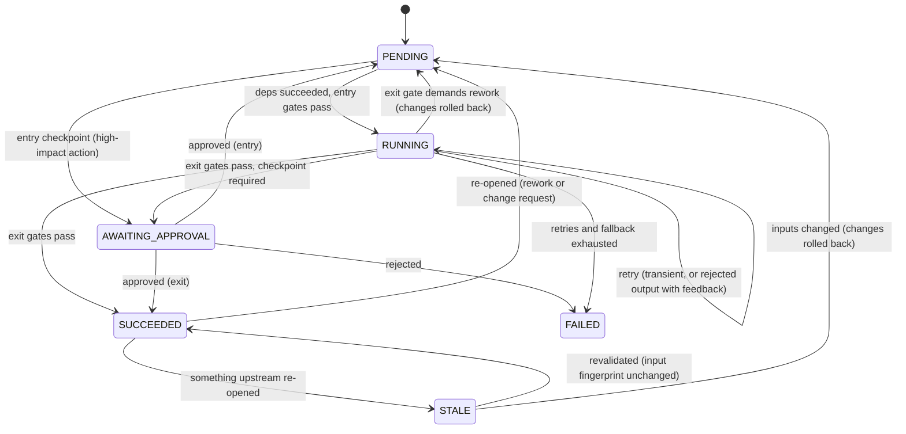
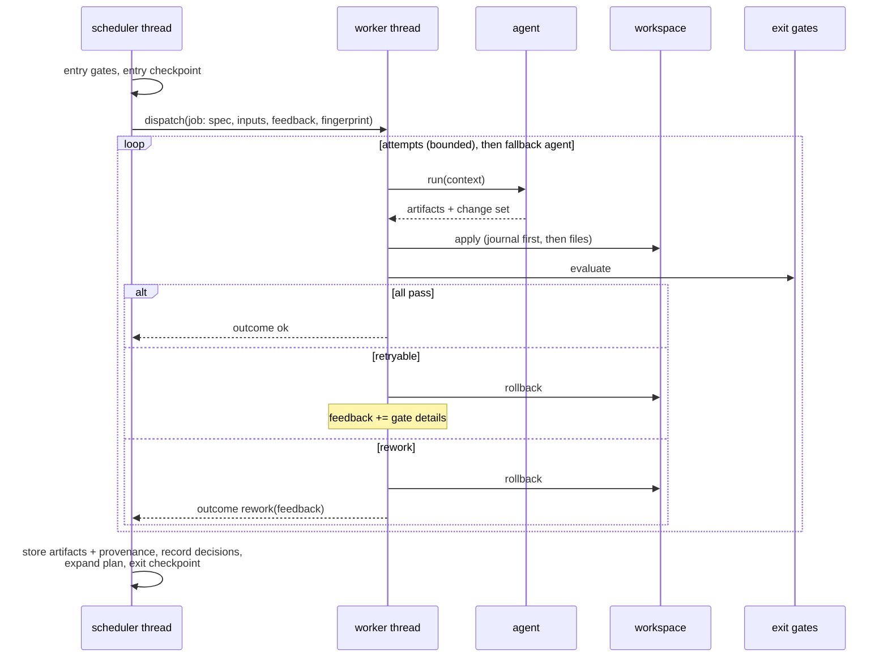

# Architecture

## 1. What the system is

A requirement goes in; a reviewable engineering outcome comes out: a normalised spec, a
design with recorded decisions, a task graph, code and tests in a sandbox, test and
security evidence, documentation, and - only after a human approves - the change promoted
onto the target codebase. An **orchestrator** owns the process; **agents** do the work of
each stage; **gates** judge the work; **humans** own the decisions that matter.

The design principle throughout: *agents propose, deterministic code disposes*. An agent
never decides whether its own output is acceptable, never writes a file directly, and has
no way to grant itself an approval.

## 2. Components

| Component | Responsibility | Why it is separate |
|---|---|---|
| `workflow.py`, `graph.py` | The SDLC as data: nodes, dependencies, gates, checkpoints, rework edges; validation, ordering, descendants | The process can be read, rendered (`sdlc graph`) and tested without running anything |
| `engine.py` | Scheduling, retry/fallback, rework, invalidation, safe-stop | The only writer of run state |
| `gates.py` | Named deterministic predicates over artifacts and workspace | Acceptance is never a model's opinion |
| `policy.py` | Security, compliance and change-control rules as pure functions over data | Guardrails are testable in isolation and configurable |
| `workspace.py` | Sandbox path confinement, atomic journalled changes, rollback, promotion | Every file effect goes through one audited door |
| `approvals.py` | Checkpoint requests, review packets, decision providers | Humans can be a terminal, a CLI call or (for demos) a labelled script |
| `store.py`, `audit.py` | Durable state, versioned artifacts with provenance, tamper-evident events | Resume, lineage and metrics all read from here |
| `agents/` | One class per role | Roles are swappable; deterministic roles need no model at all |
| `providers/` | How a model-backed role gets its output | Live model and offline replay are interchangeable |

## 3. Orchestration model

### 3.1 The graph

- **Sequential and parallel paths with synchronisation.** `codebase_scan` and `requirements`
  run in parallel and join at `architecture`. Plan tasks run in parallel wherever the plan
  has no edge between them and join at `implementation`. `verification`, `security_review`
  and `documentation` run in parallel and join at `release_readiness`. Parallelism is real
  (a thread pool); a test proves it with a barrier that only opens when two tasks execute
  at once.
- **Dynamic shape.** The plan is an agent output, so the task nodes do not exist until
  planning has run. `engine._expand_plan` turns each task into a node wired with the
  plan's own `depends_on` edges, and the join node's dependencies become "all tasks".
- **Non-linear.** Dotted edges are not dependencies but recovery paths: a failed exit gate
  can re-open upstream work, and a human can send any checkpoint back to any upstream node.

### 3.2 Entry and exit gates

Every node declares entry gates (may it start?) and exit gates (may its output be used?).
A failing gate also says *how* to recover.

| Stage | Entry gates | Exit gates | On exit failure |
|---|---|---|---|
| requirements | budget | well-formed, ids unique, acceptance criteria present | retry with feedback |
| architecture | inputs, budget | every requirement covered; decisions, mitigations and rollback plan present; **impacted modules exist in the real codebase** | retry with feedback |
| planning | inputs, budget | DAG; two-way requirement traceability; **no file shared by tasks that could run in parallel**; reserved and forbidden paths | retry with feedback |
| impl task | inputs, budget, *change-control approval if high impact* | change within declared scope; policy scan of changed files | retry with feedback |
| implementation (join) | all tasks done | every task produced a change; workspace parses | rework |
| verification | inputs | tests pass; coverage threshold; every functional requirement has a test | rework |
| security review | inputs | no blocking finding | rework |
| documentation | inputs, budget | in scope; policy scan; OpenAPI exported from the running app | retry, fallback agent, or rework |
| release readiness | inputs, upstream current | release checklist all green | fail |
| promotion | **no change freeze; target unchanged since the sandbox was seeded** | - | safe-stop |

### 3.3 Node lifecycle

### 3.4 Executing one node

Three rules keep this safe under concurrency:

1. **Single writer.** Workers return an `Outcome`; only the scheduling thread mutates run
   state. The audit log and the workspace are the only structures workers write, and both lock.
2. **Quiescent restructuring.** Rework, change requests and re-planning are queued and
   executed only when no agent is running, so a rollback can never race a running task.
3. **Disjoint writes by construction.** The plan gate refuses two tasks that could run in
   parallel and write the same file, and documentation paths are reserved for the
   documentation stage; the scope gate enforces both at runtime.

### 3.5 Recovery: retry, fallback, rework, rollback, safe-stop

| Mechanism | Trigger | Bound | What happens |
|---|---|---|---|
| Retry with backoff | `TransientError` (timeout, rate limit, 5xx) | `RetryPolicy.max_attempts` (3), exponential delay | Same call again |
| Retry with feedback | Output fails its schema or a `retryable` gate | same attempt budget | Changes rolled back; the agent is called again with the rejection reasons |
| Fallback agent | Primary agent exhausted or permanently failed | one fallback per node | e.g. documentation falls back from the model writer to a template writer |
| Rework | An exit gate marked `rework` fails (tests, coverage, security, consistency) | `Policy.max_rework_rounds` (2) | The tasks whose files appear in the failure output are re-opened with that output as feedback; if none match, all are |
| Node rollback | Any failed attempt; any re-opened node | - | Before-images from the journal are restored, newest change first, for the node and everything downstream that wrote files |
| Release rollback | Promotion error (automatic) or `sdlc rollback` | - | The backup taken at promotion restores the target |
| Safe-stop | `sdlc stop`, Ctrl-C, invocation or wall-clock budget, change freeze, target drift | - | No new dispatch; in-flight agents finish; state persisted; `sdlc resume` continues. A stop is never recorded as a failure |
| Crash recovery | Process died mid-node | - | On resume, nodes left `RUNNING` are rolled back and re-run |

Failure is always safe for the real codebase: agents only ever touch the sandbox, so a
failed, stopped or rejected run leaves the target exactly as it was.

### 3.6 Dynamic re-planning and invalidation

When a node is re-opened (rework, a human change request, a clarification answer):

1. its own changes and those of every downstream node that wrote files are rolled back and
   those nodes return to `PENDING`;
2. every other downstream result becomes `STALE` - kept, but not trusted;
3. when a stale node's dependencies have settled, its **input fingerprint** (hash of its
   parameters, the hashes of its input artifacts, and its feedback) is recomputed. If it is
   unchanged the previous result is kept (`node.revalidated`); otherwise the node re-runs.

Re-planning falls out of this: if the design changes, planning's fingerprint changes, it
re-runs, and `_expand_plan` diffs the new plan against the old task nodes - `added`,
`removed`, `changed`, `kept` - rolling back only what no longer matches. The plan version,
the diff and the reason are audited and recorded as an orchestrator decision.

Approvals are **bound to content**: a decision applies to the hash of what was shown. If
the plan changes, the earlier sign-off no longer applies and the checkpoint is raised again.

## 4. Governance

### 4.1 Human checkpoints

| Checkpoint | When | Role | Phase |
|---|---|---|---|
| `clarification` | Only if the requirement spec has open questions | product-owner | exit of requirements |
| `plan-signoff` | Always, before any code is changed | tech-lead | exit of planning |
| `change-control:<task>` | A task is a migration against existing data, or modifies an existing protected path | change-advisory | **entry** of that task |
| `release` | Always, before promotion | release-manager | exit of release readiness |

Whether a task is high impact is computed by the orchestrator from policy and the real
baseline (`workflow.task_node`), never taken from the planning agent's own claim. Each
decision is one of approve / reject / request changes (optionally naming an upstream
node), must be made in the checkpoint's role, and is written to the audit log and the
decision lineage with the actor's name. While one branch waits for a human, independent
branches keep running.

### 4.2 Policy guardrails (`policy.py`)

- **Security:** sandbox path confinement; secrets; `eval`/`exec`/shell/pickle; SQL built
  by interpolation (AST check on `execute` arguments); imports outside an approved
  dependency list.
- **Compliance:** schema columns that would persist raw personal data; requirement-to-test
  traceability; minimum coverage; audit chain integrity as a release-checklist item.
- **Change control:** protected and forbidden paths; change-size limits; declared-scope
  enforcement; change freeze; refusal to promote onto a target that drifted.
- **Autonomy budgets:** agent invocations, rework rounds, wall-clock time.

Guardrails run at two levels: on each change at the exit gate of the node that made it,
and on the whole workspace in the security review stage.

### 4.3 Context, lineage and audit

- **Artifacts** are versioned, content-hashed, and record `produced_by` and
  `derived_from` (artifact name -> version). `sdlc lineage <run> <artifact>` walks the chain.
- **Decisions** are first-class records (actor, title, rationale, alternatives): the
  architect's ADRs, the analyst's assumptions, every human decision, and the orchestrator's
  own choices (which tasks it blamed, that it re-planned).
- **Audit log:** append-only JSON lines; each record carries the hash of the previous one,
  so an edit, deletion or reordering is detected by `sdlc audit --verify`. Rejected
  evidence is kept too (for example `rejected:test_report`).
- **Metrics** are derived only from the audit log (`metrics.py`), so they cannot disagree
  with the record: success rate, first-pass rate, retry frequency, rollbacks, rework
  rounds, re-plans, incidents and MTTR (first failure of a node to its next success),
  end-to-end and active latency, human wait, per-stage agent time.

## 5. Agents and providers

| Agent | Kind | Output |
|---|---|---|
| Requirements analyst | model | `requirement_spec`: FR/NFR with acceptance criteria, open questions with options, assumptions, scope |
| Codebase analyst | deterministic (`ast`) | `codebase_map`: import graph, routes, tables, tests |
| Architect | model + deterministic impact | `design` (components, API, data model, ADRs, risks, coverage, rollback plan), `impact_report` (blast radius from the real import graph) |
| Planner | model | `plan`: tasks with requirement ids, dependencies and declared write sets |
| Implementer | model | a change set for one task (full writes or exact search/replace edits) |
| Verifier | deterministic | runs pytest with coverage in the sandbox; `test_report`, `traceability` |
| Security reviewer | deterministic | whole-workspace policy scan; `security_report` |
| Doc writer / template writer | model / deterministic | README and changelog; **API reference always generated from the app's OpenAPI schema** |
| Release manager, promoter | deterministic | release checklist; promotion with backup |

Model-backed agents are a role prompt, a context builder and a pydantic schema. The
provider must return schema-valid output or raise a classified error; the live provider
uses Claude structured outputs (`messages.parse`) and maps SDK errors onto the engine's
retry taxonomy, with the SDK's own retries disabled so the orchestrator is the single
retry authority.

## 6. Key decisions and trade-offs

| Decision | Alternatives considered | Why | Cost |
|---|---|---|---|
| Hand-built engine on the standard library | LangGraph, Temporal, Airflow | The assignment's differentiator is the orchestration logic itself; ~700 lines make every guarantee inspectable and testable | No distributed execution, no UI |
| Sandbox copy + promotion | Agents edit the repo; git branches | The real codebase is untouchable until a human approves, on any platform, with no git assumptions | Copies the tree per run; no merge - promotion refuses if the target drifted |
| Journal with before-images | Whole-workspace snapshots; git stash | Per-node undo is exact and works with parallel tasks | Relies on disjoint write sets, which gates enforce |
| Gates are deterministic code | A reviewer model as judge | A guardrail must not depend on a model agreeing to be safe | Heuristic scanners miss what a real SAST would find |
| Fingerprint-based revalidation | Re-run everything downstream | Unchanged work is kept; changed work is provably redone | More state to reason about (`STALE`) |
| Approvals bound to content hashes | Approval per checkpoint name | A sign-off cannot silently carry over to different content | Humans are asked again after any change |
| Scripted provider as the default | Require an API key | Deterministic, offline, reviewable evaluation of the control plane | Content quality in the demo reflects the playbooks, not live generation |
| JSON snapshot + JSONL log on disk | A database | Zero setup; human-readable evidence | Single process per run; no concurrent writers |
| Threads | asyncio; processes | Agents block on I/O and subprocesses; a single scheduling thread keeps state simple | Bounded by the pool size; no isolation between agents beyond the sandbox |

Limitations are listed in [TESTING.md](TESTING.md#limitations).
